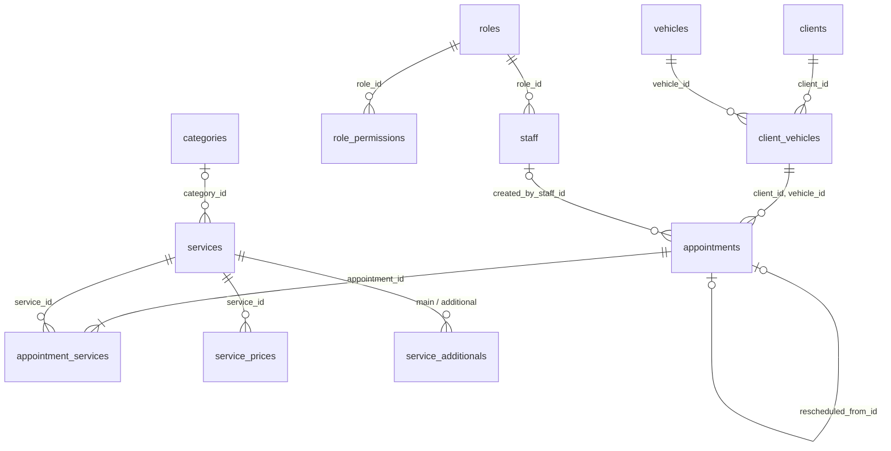

# Padrões do banco de dados

PostgreSQL gerenciado pelo Supabase. Tabelas de cada assunto: `docs/<assunto>/dados.md`. Passo a passo de migration: `workflows/procedimentos/migration.md`.

## Acesso

- RLS ativada em todas as tabelas, sem nenhuma política: a chave pública não lê nem grava nada. Só o backend, com a chave de serviço em `src/server`, acessa os dados.
- O backend não abre conexão direta com o PostgreSQL: usa a API do Supabase via `supabase-js`, que administra as conexões (evita esgotamento em funções sem servidor).
- Consultas sempre parametrizadas pelo `supabase-js`; nunca SQL montado por concatenação.

## Estrutura

- Pasta `supabase/`: `config.toml` (do `supabase init`), `migrations/`, `seed.sql` (dados obrigatórios), `seed-demo.sql` (demonstração, opcional) e `scripts/create-admin.mjs` (conta de administrador).
- Tudo por migration. Cada repositório declara o tipo das linhas que lê (`snake_case`, conforme o `dados.md`) e as converte para os tipos do código (`camelCase`); nomes de tabelas e colunas não saem de `src/server/repositories/`.
- Tabelas e colunas em inglês, `snake_case`, tabelas no plural.
- Ids `uuid` gerados pelo banco (exceções: `business_settings.id` = 1, `business_hours.weekday` 0 a 6, chaves de enum).
- Toda tabela tem `created_at`; as editáveis têm `updated_at`, mantido por gatilho e usado no controle de concorrência.
- Dinheiro em `numeric(10,2)`, percentual em `numeric(5,2)`, nunca ponto flutuante; data com horário em `timestamptz`; horário do dia em `time`.
- Domínios fechados são tipos enumerados: `permission_key`, `vehicle_type`, `vehicle_size`, `service_type`, `pricing_mode`, `payment_method`, `appointment_status`.
- Nomes explícitos de restrições e índices: `fk_`, `uq_`, `ck_`, `idx_` + tabela + colunas (`uq_vehicles_plate`). O repositório usa o nome para converter a violação no código de erro (`PLATE_IN_USE`).
- Regras de preenchimento de uma linha: `CHECK`; regras entre linhas ou que impedem mudança de coluna: gatilho. Nenhuma combinação inválida pode ser gravada, mesmo se a aplicação falhar.
- Modelo em terceira forma normal. Os dados copiados no agendamento não são redundância: registram o que valia na ordem de serviço (RN037).

## Transações

- Gravação em várias tabelas: função SQL, numa transação (RNF010).
- Funções curtas e sem chamadas externas: envio de imagem ao Storage e criação de conta no Supabase Auth ficam fora delas.
- Isolamento padrão `READ COMMITTED`; a alteração simultânea do mesmo registro é detectada pelo `updated_at` (`docs/padroes/api.md`).

## Índices

Só os de consultas frequentes em tabelas que crescem (`appointments`, `client_vehicles`; ver os `dados.md`). Em índice composto, a coluna de filtro vem antes da de ordenação. Índice novo só com consulta lenta identificada e analisada com `EXPLAIN ANALYZE`, porque cada índice deixa as gravações mais lentas.

## Exclusão (RN030)

Nada com histórico é apagado. Clientes e serviços: exclusão lógica (`deleted_at`), filtrada em toda listagem e seleção. Funcionários, cargos e categorias: desativados (`is_active`). Veículos e agendamentos: permanentes. Por isso, chave estrangeira que aponta para registro com histórico bloqueia exclusão física (`RESTRICT`); cascata só em configuração de um cargo ou serviço (`role_permissions`, `service_prices`, `service_additionals`).

## Modelo

Tabelas sem relacionamento: `business_settings`, `business_hours`, `payment_fees`, `login_attempts`. `staff.id` referencia `auth.users`; `clients.id` não, porque a exclusão do cliente remove a conta do Supabase Auth.

## Migrations

Só acrescentam; remoção em migration posterior, quando o código publicado já não usa o item; migration aplicada nunca é editada; aplicação pelo integrante designado, nunca pelo agente nem pelo CI.
